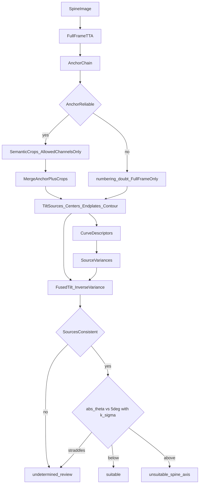
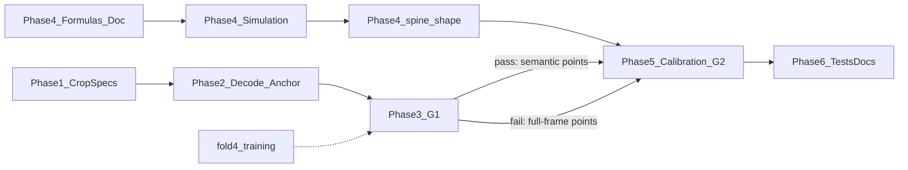

# Семантические кропы позвоночника и исправленный расчёт наклона — детальный план

## 0. Исходные факты и трактовка ТЗ

**Что не так в v1:** каждый кроп декодировал все 29 каналов и собирал полную цепочку L1–L4. Из-за этого на фрагменте с L2–L3 физический L2 получал имя «L1». Отсюда v1 даёт 28/72 ошибок уровня и p90 32 мм.

**Базовые значения, которые нельзя ухудшить (полный кадр, OOF folds 0–3):**

- p90 ошибки точек позвоночника — 10.14 мм;
- ошибки уровня — 10/72 кадров;
- ошибка угла оси — медиана 0.374°, p90 1.246°;
- `spine_axis` по контуру — F1 0.33;
- сервис по позвоночнику — F1 0.57.

**Данные для калибровки без DICOM:**

- `data/keypoints.npz` содержит 92 снимка позвоночника, из них 91 с размеченными L1–L4;
- `spine_qc/measurements.csv` содержит `y_axis` (10), комментарии «сколиоз» (14), фолды и контурные признаки;
- связь между файлами по `study` — один к одному.

`НД_для_обучения` пуста, поэтому все гейты считаются офлайн.

**Трактовка ТЗ** ([DATASET.md](DATASET.md), [README.md](README.md)):

- критерий — технический наклон оси кадра больше 5°;
- сколиоз не дефект качества, а помеха измерению. Его геометрия искажает угол, и это искажение надо вычесть;
- порог 5° не поднимается; меняется оценка угла;
- укладка, артефакты и видимость Th12/таза остаются независимыми критериями.

**Предварительная проверка на GT-точках (91 снимок).** Порог для каждой оценки подобран на тех же данных, поэтому это оптимистичная оценка, обосновывающая направление:

| Оценка наклона | AUC по `y_axis` | Лучший F1 | TP/10 | FP | FP на сколиозе /11 |
|---|---|---|---|---|---|
| МНК по центрам L1–L4 (как сейчас) | 0.82 | 0.41 | 8 | 21 | 8 |
| Контур `spine_qc` | 0.83 | 0.48 | 6 | 9 | 4 |
| Средний угол замыкательных пластинок | 0.87 | 0.56 | 5 | 3 | 2 |
| Центры, исправленные по пластинкам (грубое правило) | 0.89 | 0.57 | 6 | 5 | 2 |

Ещё наблюдения на тех же точках:

- `corr(θ_C, θ_E) = 0.91`: на прямых спинах центры и пластинки дают один и тот же наклон;
- медиана `|θ_C − θ_E|`: норма 0.94°, истинный наклон 0.76°, сколиоз 1.57°. Сколиоз смещает именно линию центров;
- линия подвздошных гребней с наклоном позвоночника не связана (`r = −0.06`), поэтому как ориентир не используется.



---

## Фаза 1. Спецификации кропов из разметки

**Новый файл** `tools/analyze_spine_crops.py`. Вход — [Разметка.json](Разметка.json) (`dxa-crops-v1`, 359 кропов, 92 снимка) и GT из `data/keypoints.npz`.

1. **Ранг кропа.** Кропы снимка сортируются по `y0`, ранг — 0..3. Если кропов не 4, ранг определяется по ближайшему центру box в долях высоты.
2. **Частоты** каналов в `included_points` по рангу:
   - ≥0.90 — output;
   - 0.40–0.90 — context;
   - ниже 0.40 — forbidden.
3. **Отступы окна в шагах.** По GT строятся `step = (L4 − L1)/3` и проекции верха и низа box на ось цепочки: `t_top`, `t_bottom` от `l1_center`. Сохраняются p25/p50/p75; ширина — полная.
4. **Проверки:**
   - соседние ранги перекрываются хотя бы одним центром;
   - каждый центр L1–L4 есть в output хотя бы одного ранга;
   - `th12_top` не попадает в output;
   - **для каждого L1–L4 оба края тела есть в output хотя бы одного ранга** — без этого не посчитать пластинку.

Результат — `configs/spine_multicrop.yaml`:

```yaml
version: semantic-v2
specs:
  t12_l1: {rank: 0, output: [...], context: [...], window_t: {p25: [..], p50: [..], p75: [..]}}
  l1_l2:  {rank: 1, ...}
  l2_l3:  {rank: 2, ...}
  l3_l4:  {rank: 3, ...}
refine_radius_step: 0.5
edge_margin_px: 10
min_crop_px: 96
```

## Фаза 2. Маскированный декод, якорь и сшивка

- **[src/dxa_qc/infer.py](src/dxa_qc/infer.py):**
  - `Predictor.heatmaps_tta(image) -> (29,H,W)` — вынести из `predict` без изменения поведения;
  - новый `predict_semantic(image, config)`;
  - старый `predict_multicrop` остаётся как `all_channel_v1`.
- **[src/dxa_qc/multicrop.py](src/dxa_qc/multicrop.py), `decode_allowed(heat, names, allowed, priors)`:**
  - вне `allowed` ничего не декодируется;
  - пик ищется только в круге prior радиусом `0.5·|step|` вокруг якорной позиции;
  - `chain_decode_hypotheses` на кропе не вызывается;
  - видимость считается по `thresholds_crop.csv`.
- **`anchor_quality(pred, chain_info)`** — якорь ненадёжен при любой из причин: `centers_missing`, `chain_ambiguous` (зазор гипотез меньше `gap_min`), `step_irregular` (отношение шагов больше 1.6), `th12_inconsistent`, `pelvis_inconsistent`. Ненадёжный якорь: кропы не запускаются, ставится `numbering_doubt`.
- **Окна от якоря:** `y0/y1 = L1_y + t_{top/bottom}·step_y`. Из трёх кандидатов (p25/p50/p75) выбирается окно с максимальным score:

  ```
  score = Σ log conf(output) + 0.5·Σ log conf(context) − λ_edge·#(output у края)
  ```

- **`merge_semantic`:**
  - источники — якорь и кропы, где канал в output и пик внутри окна;
  - при расхождении больше 6 мм отбрасывается дальний от медианы;
  - итог — взвешенное по `conf` среднее;
  - центр уходит от якоря не дальше `0.25·|step|`, иначе остаётся якорь;
  - для каждой точки сохраняются `n_sources` и `spread_px` — они нужны для дисперсий в фазе 4.

## Фаза 3. Качество точек (гейт G1)

Режимы `--multicrop {off,v1,oracle,auto}` в [src/dxa_qc/evaluate.py](src/dxa_qc/evaluate.py). Пороги кропов и `gap_min` калибруются только на train-фолдах (`tools/calibrate_crop_thresholds.py` → `runs/keypoints_crops/thresholds_crop.csv`).

G1 (auto против full-frame на тех же кадрах):

| Метрика | Требование |
|---|---|
| Ошибки уровня | ≤8/72 |
| p90 позвоночника | ≤10.14 мм |
| p90 ошибки угла центров `θ_C` | ≤1.25° |
| p90 ошибки угла пластинок `θ_E` (новая метрика) | не хуже full-frame |
| Кадры с ≥3 парами краёв | ≥80% |
| Декод forbidden-каналов | 0 (unit-тест) |

Развилка по результату:

- oracle не проходит — кропы останавливаются;
- проходит только oracle — сервис на full-frame, дорабатываются окна;
- fold4 обучается в фоне, прод-включение только после пересчёта на 5 фолдах.

Фазы 4–5 не ждут G1: они работают с любым источником точек (GT, full-frame, semantic).

---

## Фаза 4. Модель ошибки угла при сколиозе и исправленная оценка

Полный вывод формул с рисунками записывается в новый `docs/AXIS_GEOMETRY.md` **до кода**. Обязательный набор формул — ниже. Каждая формула получает unit-тест на синтетике (фаза 6).

### 4.1. Обозначения

- координаты переводятся в мм через `pixel_mm`; `y` направлен вниз, угол `θ` отсчитывается от вертикали, положительный — верх позвоночника смещён вправо в кадре. Знаки всех источников приводятся к этой конвенции;
- центры `c_k = (x_k, y_k)`, `k = 1..4` (L1..L4), веса `w_k` = уверенность модели;
- пары краёв `e_k^R, e_k^L` и середины тел `m_k = (e_k^R + e_k^L)/2`;
- шаг `s = (c_4 − c_1)/3`, длина `L = |s|`, единичная ось `u = s/L`, нормаль `n = (u_y, −u_x)`;
- параметр вдоль оси `t_k = (c_k − c̄)·u / L`; для ровной цепочки `t ≈ (−1.5, −0.5, 0.5, 1.5)`.

### 4.2. Модель кадра

```
c_k = R(θ_T)·[0, y_k]^T + δ_k·n + ε_k
α_k = θ_T + γ_k + η_k
```

- `θ_T` — технический наклон, то есть искомая величина;
- `δ_k` — боковое смещение тела позвонка из-за дуги сколиоза;
- `γ_k` — собственный наклон тела позвонка в дуге;
- `ε_k`, `η_k` — ошибки модели точек.

У прямой спины `δ ≡ 0`, `γ ≡ 0`.

### 4.3. Источник 1 — линия центров

Взвешенный МНК `x` по `y` (текущая формула `axis_angle`):

```
θ_C = atan( Σ w_k (y_k − ȳ)(x_k − x̄) / Σ w_k (y_k − ȳ)² )
```

**Смещение от дуги** — это проекция боковых смещений на линейный член:

```
Δθ_C ≈ Σ w_k (t_k − t̄) δ_k / ( L · Σ w_k (t_k − t̄)² )
```

Для C-дуги радиуса `R` (кривизна `κ = 1/R`) с вершиной в `t_a`: `δ(t) = −κ L² (t − t_a)²/2`, и при симметричных `t` получается

```
Δθ_C ≈ κ · L · (t_a − t̄)
```

То есть МНК по центрам измеряет касательную дуги в середине окна L1–L4, а не наклон кадра. Ошибка равна углу дуги между серединой окна и вершиной. Если вершина в середине окна, ошибки нет; если у края, ошибка максимальна.

Для S-изгиба `δ(t) = c_3 t³`: `Δθ_C ≈ c_3 · Σt⁴ / (L·Σt²)`.

**Принципиальное ограничение, которое фиксирует документ:** парабола, повёрнутая на малый угол, снова парабола. Поэтому по одним центрам наклон и дугу разделить нельзя, нужен второй независимый источник.

### 4.4. Источник 2 — замыкательные пластинки

- наклон тела позвонка: `α_k = −atan2(Δy_k, Δx_k)`, где `(Δx_k, Δy_k) = e_k^L − e_k^R` с `Δx_k > 0`; знак приводится к конвенции `θ`, как в проверке выше (`r = 0.91`);
- оценка: `θ_E = Σ v_k α_k / Σ v_k`, веса `v_k = 1/σ_{α,k}²`;
- шум пластинки от ошибки точек `σ_pt`: `σ_{α,k} ≈ √2·σ_pt / W_k` рад, где `W_k = |e_k^L − e_k^R|` — ширина тела. Отсюда видно, почему точность краёв критична: при `W ≈ 40 мм` и `σ_pt = 2 мм` один позвонок даёт около 4°, среднее по четырём — около 2°;
- смещение от дуги `Δθ_E = mean(γ_k)`. Гипотеза из данных: `|Δθ_E| < |Δθ_C|` (медиана `|θ_C − θ_E|` у сколиоза 1.57° против 0.94° в норме). Это проверяется, а не предполагается.

### 4.5. Источник 3 — контур `spine_qc`

`θ_K = angle_deg` из [spine_qc/criteria.py](spine_qc/criteria.py). Это плотный трек, но на сколиозе он даёт выбросы до ±7°. Его дисперсия раздувается по `curvature_mm` и `half_angle_diff_deg` по той же схеме, что и у центров.

### 4.6. Дескрипторы дуги и дисперсии источников

`curve_descriptors()` возвращает:

- остатки `r_k = (c_k − ĉ_k)·n` после МНК;
- `κ̂ = 2·q_2 / L` — квадратичный коэффициент `x(t) = q_0 + q_1 t + q_2 t²` в системе `(u, n)`;
- `t̂_a = −q_1/(2 q_2)`, если вершина попадает в окно `[−2, 2]`;
- разброс сегментных углов `seg_range = max − min` угла отрезков `c_k → c_{k+1}`;
- разброс пластинок `spread_α = std(α_k)`;
- рассогласование `D = θ_C − θ_E`.

Дисперсии с поправкой на дугу (идея: источник, которому дуга вредит, получает меньший вес):

```
σ_C² = σ_{C0}² + (b_C · |κ̂| · L · max(|t̂_a − t̄|, τ))² + (b_r · rms(r)/L)²
σ_E² = σ_{E0}² / n_E + (b_E · spread_α)² / n_E
σ_K² = σ_{K0}² + (b_K · curvature_mm / L)²
```

- `σ_{C0}`, `σ_{E0}`, `σ_{K0}` — шум источника на прямых спинах: std разности «предсказание − GT» угла на OOF-точках прямых спин;
- `b_*`, `τ` — безразмерные коэффициенты влияния дуги, подбираются в фазе 5;
- если вершина вне окна, `t̂_a` не определена, и используется `τ` (по умолчанию 1.5 шага).

### 4.7. Слияние

```
θ̂ = (θ_C/σ_C² + θ_E/σ_E² + θ_K/σ_K²) / (1/σ_C² + 1/σ_E² + 1/σ_K²)
σ̂ = (1/σ_C² + 1/σ_E² + 1/σ_K²)^(−1/2)
```

Проверка согласованности (χ² с двумя степенями свободы):

```
Q = Σ_i (θ_i − θ̂)² / σ_i²
```

Если `Q > χ²_{2;0.99} = 9.21`, источники противоречат друг другу сильнее, чем объясняет дуга. Это ошибка точек или нумерации, и решение уходит в ручную проверку.

Если пар краёв меньше двух, `θ_E` не используется. Слияние идёт по центрам и контуру, а `σ̂` честно растёт.

### 4.8. Синтетическая проверка формул

`tools/simulate_axis_bias.py`:

- берутся GT-точки 70 прямых спин;
- кадр поворачивается на известный `θ_T ∈ [−8°, 8°]`;
- накладывается дуга `δ(t)`: C (`κL ∈ [0, 0.3]`, `t_a ∈ [−3, 3]`) и S (`c_3`);
- пластинки поворачиваются по трём вариантам `γ`: `0`, `0.5·касательная`, `касательная`;
- добавляется шум точек `σ_pt` из OOF.

Для каждого эстиматора (`θ_C`, `θ_E`, `θ_K`, `θ̂`) строятся карты `|θ_est − θ_T|` по `(κL, t_a, γ-вариант)`. Проверяется, что формула `Δθ_C ≈ κL(t_a − t̄)` совпадает с численной ошибкой (тест), и что `θ̂` не хуже лучшего одиночного источника ни в одной ячейке более чем на 0.3°.

Синтетика зависит от предположения о `γ`, поэтому финальное слово за реальными данными (фаза 5).

### 4.9. Код

[src/dxa_qc/spine_shape.py](src/dxa_qc/spine_shape.py) содержит только чистые numpy-функции:

```python
def tilt_sources(points, visible, names, pixel_mm, contour=None) -> dict      # θ_C, θ_E, θ_K, α_k, W_k, n_E
def curve_descriptors(points, visible, names, pixel_mm) -> dict              # κ̂, t̂_a, r_k, seg_range, spread_α, D
def source_variances(src, curve, params, point_sigma) -> dict                # σ_C, σ_E, σ_K
def fused_tilt(src, sig) -> dict                                             # θ̂, σ̂, Q, weights
```

`point_sigma` — по каналу из OOF-ошибок или из `meta.spread_px` semantic-merge (фаза 2), если он доступен.

---

## Фаза 5. Калибровка и решение по оси (гейт G2)

### 5.1. Калибровка — [spine_qc/calibrate.py](spine_qc/calibrate.py), режим `--axis-fused`

- `σ_{C0}`, `σ_{E0}`, `σ_{K0}`, `σ_pt` считаются по OOF-предсказаниям модели точек относительно GT, только на train-фолдах;
- `b_C`, `b_E`, `b_K`, `b_r`, `τ` и множитель `k` подбираются вложенно по исследованиям. Сетка: `b ∈ {0, 0.5, 1, 2, 4}`, `τ ∈ {1, 1.5, 2}`, `k ∈ {0, 0.5, 1, 1.5}`;
- целевая функция — максимум F1 `spine_axis` при FN не больше базового и `undetermined` ≤15%;
- порог `thr = 5°` фиксирован. Отдельно сообщается, какой `thr` оптимален по данным, чтобы увидеть, совпадает ли разметка эксперта с 5°. В вердикт идёт 5°, если разница не принципиальная;
- три источника точек: GT (верхняя граница), OOF full-frame, OOF semantic (если прошёл G1).

### 5.2. Решение — `axis_decision()` в [spine_qc/criteria.py](spine_qc/criteria.py)

Одна функция для контура и точек. Заменяет `axis_from_points` в [service/keypoints_backend.py](service/keypoints_backend.py) и ветку `axis_is_straight` контурного правила.

| Условие | Состояние | Флаги / нарушения |
|---|---|---|
| Нет L1–L4, `numbering_doubt` или меньше двух источников | `undetermined` | `axis:needs_review`, причины |
| `Q > 9.21` | `undetermined` | `axis:sources_disagree` |
| `|θ̂| + k·σ̂ < 5°` | `suitable` | — |
| `|θ̂| − k·σ̂ > 5°` | `unsuitable` | violation `spine_axis` |
| Иначе (интервал накрывает 5°) | `undetermined` | `axis:borderline` |

Сколиоз отдельным флагом решения не является. В details выводятся дескрипторы дуги и **величина поправки** `θ_C − θ̂`, чтобы было видно, насколько дуга исказила бы старый расчёт.

### 5.3. Встраивание — [service/pipeline.py](service/pipeline.py) и `keypoints_backend.py`

`details.keypoints.axis` содержит:

- `theta_fused_deg`, `sigma_deg`;
- `theta_centers_deg`, `theta_endplates_deg`, `theta_contour_deg`;
- `weights`, `Q`, `curve`;
- `correction_deg`, `state`, `reasons`.

Правила:

- `undetermined` по умолчанию даёт флаг и `quality_probability ≥ 0.5`; вариант `axis_undetermined_policy: violation` — в конфиге;
- без модели точек `axis_decision` работает на `θ_K` с его `σ_K`, то есть контурное правило получает ту же логику;
- `spine_position`, `spine_artifacts` и видимость Th12/таза не меняются.

### 5.4. Гейт G2 (OOF, офлайн)

| Метрика | Требование |
|---|---|
| F1 `spine_axis` | > 0.33 (контур) и > F1 чистого `θ_C` на тех же точках |
| FP на 11–14 сколиозах | минус ≥50% относительно `θ_C` |
| Потеря истинных `spine_axis` | ≤1 из 10 |
| `undetermined` | ≤15% spine-кадров |
| Синтетика | `θ̂` не хуже лучшего источника более чем на 0.3° ни в одной ячейке |
| F1 позвоночника (офлайн-реконструкция) | ≥0.57 |

Если G2 не пройден, все источники и `θ̂` остаются в details, а вердикт — за текущим правилом.

---

## Фаза 6. Оверлеи, тесты, документация

**Оверлеи** ([tools/export_keypoint_overlays.py](tools/export_keypoint_overlays.py)):

- окна кропов и output-точки;
- три линии наклона (центры, пластинки, контур) и итоговая `θ̂ ± σ̂`;
- отрезки пластинок `α_k`, хорда и остатки `r_k`;
- в подписи `state` и `correction_deg`.

**Тесты** `src/dxa_qc/test_spine_shape.py`:

- прямой повёрнутый на `θ` позвоночник: все источники равны `θ` с точностью до 0.05°;
- C-дуга без поворота с вершиной в `t_a`: `θ_C` совпадает с `κL(t_a − t̄)`, а `θ̂` близок к 0 при `γ = 0`;
- зеркальное отражение меняет знак всех углов;
- выброс одной точки края даёт рост `Q` и `undetermined`;
- меньше двух пар краёв — `θ_E` не участвует, `σ̂` растёт.

**Тесты** `src/dxa_qc/test_multicrop.py`:

- forbidden-каналы не декодируются;
- prior не даёт уйти на соседний уровень;
- ненадёжный якорь даёт `numbering_doubt`.

**Тесты** `spine_qc/test_axis_policy.py`: все пять строк таблицы решений.

**Документация:**

- `docs/AXIS_GEOMETRY.md` — вывод формул, синтетика, таблица G2;
- [docs/KEYPOINTS.md](docs/KEYPOINTS.md) — v1 против semantic v2;
- [docs/USER_GUIDE.md](docs/USER_GUIDE.md) — что значат три угла и поправка.

---

## Порядок и зависимости



Фазу 4 можно начинать сразу параллельно с кропами: формулы и синтетика проверяются на GT-точках. Точность краёв тел становится главным требованием к модели точек, так что G1 включает ошибку угла пластинок.

## Затрагиваемые файлы

- **Новые:**
  - `tools/analyze_spine_crops.py`
  - `configs/spine_multicrop.yaml`
  - `tools/calibrate_crop_thresholds.py`
  - `docs/AXIS_GEOMETRY.md`
  - `tools/simulate_axis_bias.py`
  - `src/dxa_qc/spine_shape.py`
  - `src/dxa_qc/test_spine_shape.py`
  - `spine_qc/test_axis_policy.py`
  - `runs/keypoints_crops/thresholds_crop.csv`
- **Изменяемые:**
  - `src/dxa_qc/infer.py`
  - `src/dxa_qc/multicrop.py`
  - `src/dxa_qc/evaluate.py`
  - `src/dxa_qc/test_multicrop.py`
  - `spine_qc/criteria.py`
  - `spine_qc/calibrate.py`
  - `service/keypoints_backend.py`
  - `service/pipeline.py`
  - `tools/export_keypoint_overlays.py`
  - документация
- **Без изменений:** обучение (кроме fold4), формат отчёта (новые поля только в `details`).

## Риски

- **Мало положительных примеров:** 10 нарушений оси и 11–14 сколиозов. Свободных параметров мало (пять коэффициентов и `k`), всё проверяется вложенным OOF, итоговые метрики — с bootstrap CI.
- **Шум краёв на предсказаниях.** Если `σ_E` на OOF окажется большим, слияние само снизит вес пластинок. Выигрыш тогда будет меньше, чем на GT, и это видно сразу, по сравнению GT и OOF в 5.1.
- **Модель `γ` (наклон тел в дуге) неизвестна.** Поэтому в синтетике три варианта, а решение принимается по реальным данным.
- **Сервисный F1** без `НД_для_обучения` проверяется только офлайн-реконструкцией.
